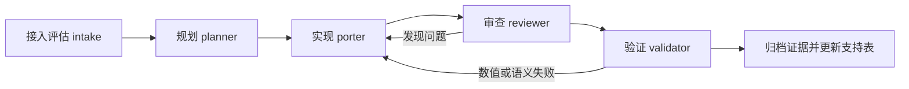

# CUDA Library Samples on ROCm：MOAT 重写与库整理实施计划

日期：2026-11-10。状态：**R9实施中：九个helper与CRC32 benchmark；R1–R8交付已归档，资格按主表统计**。

用户决定：后续代码重写和库整理采用 MOAT。本文定义接入方式、任务顺序、交付物、验收条件和详细实验记录规范。2026-11-10 用户已授权按计划持续实施；实际进展和实验结果追加到第 13 节，候选不预记为通过。

## 1. 目标、范围与基线

目标是让每次迁移都能回答：原例要求什么、为什么选择某个 AMD 库、改写了什么、在哪个环境运行、数值和执行语义是否一致、失败发生在哪一步，以及下一次应如何继续。

范围包括现有失败和部分支持入口的重新选型、算法重写、语言绑定、共享后端整理，以及已通过入口受公共代码变化影响后的回归。保留原始 CUDA 样例、稳定的样例 ID、历史失败证据和已有验收范围。

### 1.1 本计划核对的实际基线

| 项目 | 基线 |
| --- | --- |
| 实现仓库 | `../CUDALibrarySamples_ROCm`，fork：<https://github.com/zihaomu/CUDALibrarySamples_ROCm> |
| 当前分支 / 提交 | `rocm` / `c6c8eac5cbd1966438c8211b89cfb613633f6375` |
| 原始 NVIDIA 样例基线 | `8b0573b11d183d9b3a36cd2955aa31c16cc61b95` |
| 审计范围 | 866 个源文件、477 个构建定义、639 个独立源入口、30 个模块 |
| 样例状态 | 211 PASSED、24 PARTIAL、402 FAILED、2 UNSUPPORTED、0 BLOCKED |
| 尚未整例通过 | **428 个入口**，包括上述 PARTIAL、FAILED、UNSUPPORTED |
| 算子统计 | 111 个按模块去重的已验收算子/功能族，分布于 17 个模块 |
| FAILED 原因 | 329 个 `BUILD_ERROR`；73 个 `BINDING_OR_FRONTEND_MIGRATION_REQUIRED` |
| PARTIAL 构成 | 20 个已验收数值子集但存在原例合同缺口；4 个仍待独立验收 |
| 当前硬件边界 | 2 个 cuSPARSELt 入口在锁定 hipSPARSELt / gfx1201 路线上不支持；保留原生失败观察 |

基线文件摘要用于之后检查统计是否基于同一份材料：

| 文件（相对实现仓库） | SHA256 |
| --- | --- |
| `migration/samples.yaml` | `954d7c2fee21aed3ccab1550c771ff8ce20f6821a62de60bc346d7fd9cd31ccc` |
| `migration/reports/operator-support.json` | `8fe27749a0505a27c5611e2a67ce50b1c47942e38e1d5c146459264a61af62b3` |
| `migration/environments/project.lock.json` | `f252224f1eb1656102bb934781eeac165050e8a828d1e19a2e21ccc4dbf1bed3` |

基线来源：[设计与实施日志](cuda_samples_on_rocm_design.md)、[B4–B15 路线图](cuda_samples_on_rocm_roadmap.md)、[支持方式和详细日志总表](../CUDALibrarySamples_ROCm/migration/reports/support-log-index.md)、[算子支持表](../CUDALibrarySamples_ROCm/migration/reports/operator-support.md)。639 是源入口数，111 是功能族数，case 数另计；后续报表分别展示。

### 1.2 完成的定义

一个样例只有在原例范围、预登记必需用例、独立参考和执行语义全部满足时，才能升级为 PASSED。新的替代算法可以通过验收，但必须显示实际库、项目 HIP 算法、CPU 阶段及兼容边界。

计划完成度与支持程度分别记录。接入工具、完成探针或执行过全部候选，不代表所有算子已经支持。428 个未通过入口必须全部有任务去向和重试条件；本计划不预先保证全部转为 PASSED。

## 2. MOAT 接入设计

### 2.1 固定来源和适用规则

本轮只读核对的 MOAT HEAD：`7b5082cc516c61b91038295346adbe8a1b5d8315`。首次接入以该提交为基线，后续升级单独评估和记录，不追随浮动 `main` 自动改变迁移规则。

| 材料 | 固定版本链接 / 用途 |
| --- | --- |
| 总体流程 | [MOAT README](https://github.com/AMD-Ecosystem/moat/blob/7b5082cc516c61b91038295346adbe8a1b5d8315/README.md)：角色分工、状态交接、真实 GPU 验证 |
| 主 skill | [cuda-to-rocm/SKILL.md](https://github.com/AMD-Ecosystem/moat/blob/7b5082cc516c61b91038295346adbe8a1b5d8315/.claude/skills/cuda-to-rocm/SKILL.md)：策略、库替换、架构与语义检查 |
| 状态约定 | [AGENTS.md](https://github.com/AMD-Ecosystem/moat/blob/7b5082cc516c61b91038295346adbe8a1b5d8315/AGENTS.md)：锁、交接、提交版本与验证失效规则 |
| 原生替代判断 | [no-hip-equivalent.md](https://github.com/AMD-Ecosystem/moat/blob/7b5082cc516c61b91038295346adbe8a1b5d8315/.claude/skills/cuda-to-rocm/references/no-hip-equivalent.md)：区分直接移植、重实现和缺少可执行目标 |
| 验证与构建 | [validation.md](https://github.com/AMD-Ecosystem/moat/blob/7b5082cc516c61b91038295346adbe8a1b5d8315/.claude/skills/cuda-to-rocm/references/validation.md)、[strategy-a-cmake.md](https://github.com/AMD-Ecosystem/moat/blob/7b5082cc516c61b91038295346adbe8a1b5d8315/.claude/skills/cuda-to-rocm/references/strategy-a-cmake.md) |

主 skill 的 SHA256 为 `a7757e3d427b6e406b02419e79d0b2233f951998b0e3dc2b450af80ed51c7a30`。MOAT 使用 MIT 许可；引入的代码、skill 和参考材料保留原许可及来源。引用的特定架构经验需在本项目锁定环境复核。

### 2.2 控制仓库与实现仓库分开

已建立本地控制仓库 `MOAT_CUDALibrarySamples_ROCm/`；实现位于 `CUDALibrarySamples_ROCm/`。固定 upstream、包装 skill、状态适配与可恢复 bundle 已落地，详情见 `migration/moat/adapter-decisions.md`。

- 控制仓库保存 MOAT 代码、角色、工作锁、项目状态、`surface.json`、计划、任务队列和交接摘要。
- 实现仓库保存 ROCm 实现、现有逐例清单、后端注册表、输入规范、验收脚本和可公开的实验记录。
- 实现仓库的 fork 仍为 `zihaomu/CUDALibrarySamples_ROCm`。上游 MOAT 默认使用的组织、分支和发布方式需通过明确的项目适配处理，不直接操作 `AMD-Ecosystem` 组织。
- 上游 MOAT 的 `projects/<name>/status.json` 是**流程阶段**的权威记录，使用其状态工具操作。现有 `migration/samples.yaml` 是**样例支持结论**的权威记录；两者通过样例 ID、批次 ID、提交和实验 ID 关联。
- 不将 639 个入口伪装成 639 个独立 GitHub 仓库。先用一个 MOAT 项目管理本实现仓库，在项目中维护批次与逐例队列；P0 验证这种适配能否保持原有锁和版本约束。

### 2.3 先完成项目适配，再运行队列

P0 必须落实以下差异，并已写入 `migration/moat/adapter-decisions.md`：

| 上游 MOAT 行为 | 本项目适配 |
| --- | --- |
| 面向新项目及其 fork | 导入已有 fork 和既有验收，保护原始 CUDA 树与历史记录 |
| 默认要求 wave64、wave32、Windows 等覆盖 | 本阶段交付范围固定为 Linux/gfx1201/ROCm 10.1；wave64、Windows 单列待验证范围，不能登记为通过或冒充上游 MOAT 全平台完成 |
| 一个项目的整体完成状态 | 批次可完成；未完成入口仍在整体 surface 中保留 `owed` 或带理由的范围声明，不据此声称 639 入口全通过 |
| 工具、示例中可能使用其他 ROCm/CUDA 环境 | 本工作区的 ROCm 10.1 锁、设备 guard 和 CUDA 对照机设置优先 |
| 上游完整状态机与命令 | 先在沙箱验证实际 schema 和可用子命令，复用其转换和锁；适配层不手写状态字段跳过验收 |
| 上游公开贡献流程 | 当前交付为用户已有 fork；向 NVIDIA 或其他上游发 PR、留言不属于本计划执行范围 |

实现方式采用“固定版本 MOAT + 小范围配置/适配补丁 + 项目包装 skill”。上游文件与项目扩展分别存放，升级时比较差异。P0 输出可从干净会话恢复的实际命令；本文不把拟建命令写成已可运行功能。

### 2.4 五阶段交接



| 角色 | 每个批次的必需输入 | 必需产物 |
| --- | --- | --- |
| intake | 现有 ID、状态、历史日志、库能力和重试条件 | 全量任务归属、已有 AMD 路线调查、原生/重写边界；复用既有项目资料 |
| planner | intake 结论、原始源码、环境锁、适用 skill references | `plan.md`、逐例合同、依赖和 surface 映射、case 规范、误差阈值、停止与重试条件 |
| porter | 冻结合同和用例、当前实现提交 | 最小可审查修改、构建与试运行记录、依赖 manifest；不得通过减少必需用例提升状态 |
| reviewer | diff、原始合同、源码和构建依赖 | 逐项审查结论，重点查 CPU 回退、host/device 替代、假多 GPU、空图、精度和布局变化 |
| validator | 审查通过的固定提交、同输入 fixture、独立参考 | AMD/CPU/CUDA 结果、负向检查、执行语义证据、逐项结论和未完成项 |

角色是可恢复的阶段，不要求同时驻留五个进程。规划、实现、审查遵守项目写锁；验证只针对冻结提交。验证代码与实现采用独立计算方法，审查和验证阶段不直接修实现后给自己通过结论，发现问题交回 porter。

### 2.5 让后续任务自动遵循同一流程

P0 在实现仓库建立 `.agents/skills/cuda-library-to-rocm/SKILL.md` 项目包装 skill，并在项目 `AGENTS.md` 写明：代码重写、库选型/替换、公共后端整理都从该入口进入。包装 skill 读取锁定 MOAT 主 skill 和相应角色/参考文件，再加载本项目环境、合同、日志和支持表规则。

MOAT 路径、upstream commit、适配版本、skill hash 与控制项目名已登记在 `migration/moat/lock.json`；共享文档不写死个人机器上的控制仓库绝对路径。缺少控制仓库或版本不符时记录接入前置条件缺失，不能静默换用另一版同名 skill。多 agent 工具的调度方式与角色规则分开，角色模型选择按运行环境记录，不照搬上游文件中的某个模型名称。

每次交接记录任务输入、可审查决策摘要、采取的工具动作、输出文件、当前提交和下一步。实际可获取的 agent/model/工具版本也写入记录；恢复依赖持久化材料，不依赖先前聊天窗口仍然存在。

## 3. 库整理方案

### 3.1 建立逐例后端注册表

已建立 `migration/libraries.json`、`migration/backend-routes.json` 和对应 schema。前者描述库，后者描述“原始样例 → 实际执行路线”。现有 `ecosystem-mappings.json`、`ecosystem-decisions.json` 和 `samples.yaml` 通过转换工具关联，避免手工维护相互矛盾的库名单。

库记录包括：库 ID、上游/许可、版本/源码提交、构建与运行时路径、包与动态库 hash、架构/精度限制、CPU/GPU 角色、候选/已探测/已验收状态、环境和实验 ID。

路线记录包括：原始样例 ID、功能合同版本、路线 ID、native/hybrid/rewrite 类型、实际库与项目源码、各阶段运行位置、布局转换、CPU 阶段用途、必需依赖、能力探针、适用 profile、验收证据和替代路线。

不得用“候选库”填充“实际使用库”。`probe_passed` 与 `sample_qualified` 分开；同一库在不同 dtype、布局、架构和版本下分别限定范围。

### 3.2 代码布局与构建

以下为拟新增或逐步归并的位置，不在一次提交中移动全部历史实现：

```text
CUDALibrarySamples_ROCm/
  rocm/
    common/                  # 运行时、错误处理、资源、设备检查与数据描述
    backends/
      blas/ solver/ sparse/ tensor/ fft/ rng/ image/ codec/ distributed/
    device/
      blas/ solver/ fft/ rng/ codec/   # 可在调用方 HIP kernel 内使用的算法
    adapters/
      c/ fortran/ python/ vendor_contracts/
    ported/<原始模块>/<原始样例>/       # 保留逐例入口和来源关系
  cmake/                     # 依赖探测、目标注册、环境/架构传参
  migration/moat/             # MOAT 锁、适配说明、任务/surface 映射
  migration/rewrite/          # 批次、合同、输入及验证规范
  tools/moat/                # 状态、实验、归档与现有报表的桥接工具
```

已有 `rocm/cuBLAS` 等 M1 路径也先保留。仅当某个重写批次实际需要共享能力时抽取公共代码，更新依赖关系和受影响回归；为移动而移动的目录调整不作为功能交付。

当前 `rocm/CMakeLists.txt` 主要按 `migration/m1.json` 注册 M1 目标，且仍含 gfx1201 的专用编译参数。P1 扩展为按路线注册目标、显式区分 host-library 与 HIP device 编译，架构从锁定 profile/构建参数传入。锁定运行仍使用 gfx1201，不把该架构硬编码到可复用算法中。

必要库缺失应在目标能力报告中明确失败或缺依赖，不允许静默跳过后让整批显示成功。可选依赖与 CPU 元数据/参考依赖分开；C/Fortran/Python 绑定调用同一已验收 GPU 核心。

### 3.3 后端路线优先级

| 功能域 | 优先复用的已用或候选能力 | 必须保留的区别 |
| --- | --- | --- |
| BLAS / Lt | hipBLAS、rocBLAS、hipBLASLt；缺口用真实 HIP packing/3M/整数计算 | 数学结果、3M 算法、特殊布局、低精度 scale、搜索/调优接口分别验收 |
| 稀疏 / 求解 | hipSPARSE/rocSPARSE、hipSOLVER/rocSOLVER、项目 HIP；允许已声明的 CPU 符号分析 | GPU 数值计算与 CPU 回退；一般稀疏与结构化 2:4；真实稀疏与 dense 转换 |
| FFT / tensor / RNG | hipFFT/rocFFT、hipTensor、rocBLAS、rocRAND 与 HIP 转换 | host/device 调用、精度、callback/JIT、随机序列与分布合同分别记录 |
| MathDx | 调用方 kernel 内的项目 HIP device 算法；rocRAND device 能力按实际探针使用 | host 库 API 不能代替设备内算子或融合阶段 |
| 多 GPU / MPI | MPI + RCCL + 局部数学库 + HIP 分布/通信 | 单进程多 GPU 与多进程、多 rank 同卡与异卡、descriptor、通信 dtype、子矩阵范围 |
| 图像 | 已有 HIP 算法；RPP/rocJPEG 仅在相应功能与格式实测后复用 | GPU 核心、CPU 文件/元数据处理、CPU codec fallback、原生像素语义 |
| 压缩 | hipCOMP 实际可用算法 + 项目适配 | host/device API、encode/decode、原始 bitstream 互操作和 benchmark 框架 |
| 其它专用 SDK | 单独做原生替代与算法可行性评估 | 未实现、缺 SDK、CPU 替代、闭源二进制限制不得合并成“永久不支持” |

## 4. 阶段、依赖和交付物

新阶段使用 P0、P1、R1–R8，与历史 B4–B15 区分。日历时间取决于 GPU 预约、原生 SDK 和单例复杂度；按可验收批次推进，不提前承诺完成日期或新增通过数。

| 阶段 | 内容 | 主要交付 | 退出条件 | 当前状态 |
| --- | --- | --- | --- | --- |
| P0 | MOAT 项目接入、环境和日志基础 | 固定版本控制仓库、包装 skill、适配说明、639 入口队列、状态/证据桥接 | 真实小型 GPU 试跑和一次失败/修复/恢复闭环均留证；流程状态与支持状态一致 | COMPLETED_SCOPED |
| P1 | 库注册表和构建整理 | 30 模块的库/路线/依赖映射、公共接口、按样例构建注册 | 639 个 ID 可定位；既有通过路线的受影响回归通过；未发生静默 CPU 替代 | COMPLETED_SCOPED |
| R1 | 5 个 BLAS/Lt 重写 | 复数 3M、PlanarComplex、INT8 布局与计算 | 第 5 节逐例合同、预登记用例、独立三方验证和反向检查 | COMPLETED_SCOPED |
| R2 | 3 个 MathDx 求解设备内重写 | partial-pivot LU、POSV、TRSM | 第 5 节原始 dtype/尺寸/执行位置通过，host API 替代检查通过 | COMPLETED_SCOPED |
| R3 | 24 个 PARTIAL 收口 | 第 6 节逐例缺失合同、可收口实现或保留原因 | 每项有当前证据与下一步；仅完整等价项升级 PASSED | ASSESSMENT_COMPLETE：2整例通过、22缺口保留 |
| R4 | 其它基础/高级算法扩展 | 稀疏 QR/IRS/SVD、低精度、图像、压缩、heuristics 等按探针拆批 | 一次只冻结一个可审查小批；完整原始合同和独立验收 | COMPLETED_SCOPED：CRC32小批，96待实现 |
| R5 | 语言绑定扩展 | 对 73 个前端失败入口逐一建立 C ABI / Fortran / Python 路线 | 先有已验收 GPU 核心，再通过原语言实际入口与数据/错误传播检查 | PARTIALLY_IMPLEMENTED：8前端通过、65仍待实现 |
| R6 | 长尾 SDK/设备算法研究 | cuEST、PQC、JPEG2000/TIFF、剩余 MathDx/分布式等分专题 | 每专题明确可实施路线、最小探针、成本和失败恢复条件 | ASSESSMENT_COMPLETE_PORTS_PENDING：224未通过 |
| R7 | 2:4 结构化稀疏替代 | 原生路线重探或真正的 HIP sparse 2:4 实现 | prune/compress/metadata/稀疏 matmul 与原例合同通过；原生失败记录保留 | COMPLETED_SCOPED |
| R8 | 阶段回归、清理与交付 | 干净检出复现、源码封存、全量统计、README 和详细报告 | 当前源码/依赖与全部选中证据一致；未完成入口有明确原因 | COMPLETED_SCOPED：16CTest＋21原始profile复现和复审通过 |

执行顺序：P0 → P1 → R1 → R2 → R3 中可收口小批；R4–R7 依赖相应核心/SDK/设备探针，逐批安排。R8 的归档和文档动作在每批结束都执行，阶段结束再做一次整体审计。

P0 用一个已通过样例演练新记录流程，演练结果不增加支持数。失败路径用独立的校验器负向输入演练，不能把未运行的故障写成真实 GPU 失败。

P1 不要求把 211 个既有通过入口全部重写。先建立依赖图；只有受实际公共代码、构建、环境或验证器变化影响的入口需要对应回归。未变化的历史证据保留原日期、环境和范围。

## 5. 首批 8 个明确重写目标

下表均为当前 FAILED 入口。路径相对实现仓库，逐例 ID 由现有 `samples.yaml` 绑定；一行是一个样例，不按复用算法重复加计。

| 批次 / 编号 | 原始入口 | 拟定实现路线 | 关键验收 |
| --- | --- | --- | --- |
| R1-01 | `cuBLAS/Level-3/gemm3m/cublas_gemm3m_example.cu` | HIP 实虚拆分/合并 + hipBLAS/rocBLAS 的三次实数 GEMM，保持 3M 运算路径 | complex alpha/beta、转置/共轭、leading dimension、完整复数输出；独立 CPU 直接复数乘法 |
| R1-02 | `cuBLAS/Extensions/Cherk3mEx/cublas_Cherk3mEx_example.cu` | 复用经验证的 3M 核心 + HIP Hermitian 三角输出处理 | 原始 dtype/累加精度、uplo、对角虚部、未指定三角区的合同、alpha/beta |
| R1-03 | `cuBLAS/Extensions/Csyrk3mEx/cublas_Csyrk3mEx_example.cu` | 3M 核心 + HIP symmetric rank-k 结果处理 | 区分转置与共轭，检查指定三角、stride 和 beta 作用 |
| R1-04 | `cuBLASLt/LtPlanarComplex/main.cpp` | HIP planar/interleaved 转换 + 原始精度对应的 complex GEMM 或实数组合 | 实虚平面偏移、layout、stride、alpha/beta、padding 未越界；转换后往返检查 |
| R1-05 | `cuBLASLt/LtIgemmTensor/main.cpp` | HIP `COL32` / `COL4_4R2_8C` packing；先探测 native INT8 路线，缺失则 HIP 整数计算 | INT8 输入/INT32 输出、转置、变换往返、非整 tile、尾部 padding；独立 CPU int64 累加检查可表示范围内的精确结果 |
| R2-01 | `MathDx/cuSolverDx/01_Linear_Solve/getrf_partial_pivot_block.cu` | 调用方 HIP kernel 内协作 partial-pivot LU | 原始 complex FP32、48×32 矩形矩阵；pivot 编号/交换、info、P·A 与 L·U 残差、需换行和奇异输入 |
| R2-02 | `MathDx/cuSolverDx/00_Introduction/posv_batched_block.cu` | kernel 内 complex Cholesky + 前/回代，复用已有设备内 Cholesky经验 | 原始 complex FP64、32×32、lower、1 RHS、2 batches；分解与解、非 SPD info、batch 隔离和共享内存边界 |
| R2-03 | `MathDx/cuSolverDx/07_BLAS/trsm_batched_block.cu` | kernel 内协作三角求解 | 原始 real FP64、32×33、right/lower/non-trans/non-unit；共享内存 lda/ldb、依赖顺序与残差 |

Planner 需再次从固定原始源码提取全部参数，生成合同后才开始实现。不得只保留上表列出的部分参数；三角未写区域、原始舍入、padding、错误行为等按原例/API 合同逐项标注。

R1 的 3M 用独立直接复数 CPU 参考，避免双方都复用同一个 3M 实现。若最终只能用常规 complex GEMM，明确记录“数学替代，3M 运算路线未实现”，不能直接把 3M 合同标为完整通过。INT8 不用浮点 dequantize 路线代替精确整数合同。

R2 必须证明计算发生在调用方 HIP kernel 内，保留必要的共享内存与协作边界，不能调用 host hipSOLVER/hipBLAS 后只复制结果。每个样例至少包含原始配置与一种修改输入的配置；线程/尺寸扩展必须是算法合法配置。

### 5.1 首批预登记用例框架

每例至少 6 个正向 case，8 例至少 **48 个正向 case**；每例至少 2 个针对本例的负向/执行语义检查，至少 **16 项检查**。这些是计划下限，目前完成数均为 0。

| case 类别 | 必须覆盖的内容 |
| --- | --- |
| original | 原始尺寸、dtype、布局、算法参数与执行模型 |
| changed-values | 从固定输入文件重放的非默认数值，alpha/beta 或矩阵值变化 |
| irregular | 合法非整 tile、矩形或非满 batch；固定尺寸模板采用另一个合法实例或不满 block 的数据分组 |
| layout | 非紧凑 lda/stride、实虚分离、变换往返或共享内存 padding，按本例适用项选取 |
| repeat | 同输入重复执行和先后变更输入，检查未初始化数据与残留状态 |
| boundary | 零/单位/抵消、需 pivot、奇异/非 SPD 或合法最小规模；按算子合同确定预期 |

负向检查包含篡改一个输出、错布局/错共轭、pivot/info 破坏、计算后不更新输入结果等实际适用项。非法参数程序行为与对输出做故障注入分别计数和标注；不能以一个必然报错的 CLI 调用代替数值校验能力证明。

误差度量在 planner 阶段冻结：浮点使用有尺度的相对/绝对误差和重构/残差，并记录 dtype、累加精度、维度及条件数影响；整数、bitstream、规定的索引/metadata 使用精确检查。阈值基于误差模型及独立 oracle 设计，不在看到失败后放宽到通过。

## 6. 24 个部分支持入口的收口顺序

R3 分成六组，覆盖恰好 24 个既有 PARTIAL。每组内部可拆成 2–4 例的小批；某一高风险项不阻断不依赖它的其它小批。

| 子组 | 入口数 / 精确范围 | 主要缺口和行动 | 升级条件 |
| --- | --- | --- | --- |
| R3-A descriptor | 4：`cuBLASMp/gemm.cu`；`cuSOLVER/MgPotrf/cusolver_MgPotrf_example1.cu`；`cuSOLVERMp/mp_getrf_getrs.c`、`mp_potrf_potrs.c` | 保留既有真实多 GPU 算法，补原始子矩阵 offset、tile、二维 process-grid、随机 SPD 输入及完整数据布局转换 | 原始 descriptor 的 gather/scatter、分解/求解、子矩阵外数据和异卡通信全部验收 |
| R3-B collective | 3：`cuBLASMp/matmul_ag.cu`、`matmul_ar.cu`、`matmul_rs.cu` | 补原始 FP16 collective 舍入；FP8/FP4、scale、transpose 和 CLI 逐项登记 | 本例要求的所有 dtype/scale/通信合同通过；只完成 FP16 时保留更窄支持范围 |
| R3-C image | 3：`NPP/nppCanny/npp_canny_simple.cpp`；`NPP/templateMatching/templateMatching.cpp`；`NPP+/floodFill/floodFillVariousRegionTypesNPPPlus.cpp` | 定位 Canny 原图 1995/921600 像素差异；补 NCC 文件/注释图/CLI/计时；补 floodFill paint/metadata/边界语义 | 数学与原生接口合同均覆盖；无原生 NPP+ oracle 的项如实记录证据缺口 |
| R3-D harness/query | 3：`nvCOMP/benchmarks/benchmark_lz4_chunked.cu`、`benchmark_snappy_chunked.cu`；`cuDSS/simple_get_set/simple_get_set.cpp` | 补完整 benchmark 参数/注册流程；逐项定义 DSS 配置/查询的可实现语义 | GPU 算法与样例 harness 都通过；无法等价的 vendor 内部查询不伪造数值 |
| R3-E RNG/solver | 5：`MathDx/cuRANDDx/01_introduction/philox_thread_api.cu`；`cuSOLVER/Xgeev/cusolver_Xgeev_example1.cu`、`cuSOLVER/Xgeev/cusolver_Xgeev_example2.cu`、`cuSOLVER/Xgeev/cusolver_Xgeev_example3.cu`；`cuSOLVER/gesvdaStridedBatched/cusolver_gesvdaStridedBatched_example.cu` | 明确 RNG LEGACY 逐位序列；查 Xgeev 实际 CPU/GPU 后端；定义 approximate SVD、rank 和 residual norm 合同，再选择重写 | 分布通过不能替代规定的 bitwise 序列；CPU LAPACK 回退不能登记为 GPU Xgeev；残差与迭代/近似语义独立检查 |
| R3-F JPEG | 6：Image-Resize、Image-Resize-WaterMark、Decoder-Backend-ROI、Decoder-MultipleInstances、Decoder 主程序及其 `tests/test_decoder.py` | 对既有 12 图输入和完整调度合同建立缺项表；评估 progressive 的真实 GPU 路线和 encoder 范围 | 仍有必需的 CPU codec fallback 或缺失执行控制时保留 PARTIAL；可先交付明确的 hybrid 版本 |

R3 的正向试验必须覆盖缺失合同，不能仅重跑此前已经通过的 120 个 case 后升级状态。缺 SDK、库后端缺失、闭源行为无 oracle 等分别保留原因和重新进入队列的条件。

## 7. 后续扩展与暂缓边界

R4–R7 先做针对性探针再冻结小批，候选不等于已使用库或保证成功。P0 的全量队列给每个未通过 ID 指定一个主阶段、可选依赖、原因和恢复条件；同一 ID 的多条路线不增加样例分母。

| 方向 | 候选内容 | 先满足的条件 |
| --- | --- | --- |
| R4 求解器 | IRS 迭代改进、csrqr、Xgesvdp/Xgesvdr、随机/截断 SVD | GPU 核心和原始精度/收敛/返回值合同；稳定、秩亏和病态输入的独立 oracle |
| R4 低精度 / 搜索 | FP8/FP4、block scale、emulated GEMM、nvMatmulHeuristics | 先冻结格式/scale/舍入；native 与软件解包/量化路线分别登记；算法 ID 不跨库直接照搬 |
| R4 图像 | CCL、contour、Hough、watershed、其它距离变换 | 完整输入、connectivity/tie/border/metadata 合同；独立 CPU 算法与原生可得输出 |
| R4 压缩 | CRC32、Cascaded/RLE；Deflate/Gzip/Zstd 按方向探测 | 检查真实 encode/decode 能力、类型和格式；CRC32 不只做自身往返；保留其它 codec 的真实缺口 |
| R4 其它 tensor/sparse | blocksparse、JIT contraction、cuSPARSE compression | 对应 API 的真实语义和输入格式；JIT 需真正生成/加载 AMD 设备代码 |
| R5 前端 | 73 个语言失败入口 | 绑定同一 GPU 核心；Fortran 数组顺序与 kind、Python stride/所有权、异步错误与资源释放分别验收 |
| R6 MathDx/JIT | 剩余 device BLAS/FFT/solver/RNG、libmathdx、nvCOMPDx | 逐项保持 device-callable/fusion 语义，运行时生成器不能用预计算结果冒充 |
| R6 分布式 | 剩余 cuBLASMp/cuSOLVERMp/cuFFTMp/cuTENSORMp/cuTENSORMg | 单机双卡与多节点分开；当前双卡结果不能外推多节点 |
| R6 专用 SDK | cuEST、剩余 cuPQC、JPEG2000、TIFF | 有可用算法定义、公开输入/输出和可行 GPU 实现；按专题立项，先做最小试点 |
| R7 sparse 2:4 | cuSPARSELt 两例 | 真正保存/使用稀疏 metadata 与压缩布局；不能改为 dense GEMM 后声称原生 hipSPARSELt 已支持 |

边界按以下四类记录，避免把“工程量大”和“不可能”混在一起：

1. **当前锁定原生路线不可用**：如 gfx1201 hipSPARSELt kernel bundle 缺失。允许新 HIP 算法路线，但保留原生失败与版本范围。
2. **可重写但尚未完成**：缺失库 API、device DSL、图像算法、格式转换等；记录算法/库目标及验证门槛。
3. **暂时缺少足够资料或 oracle**：专有 bitstream、内部配置/内存查询、未取得 SDK 等；先补可观测合同，不伪造兼容结果。
4. **无法直接移用的 NVIDIA 对象或硬件属性**：cubin/PTX 二进制、私有缓存/descriptor、专用调度和指令时序。可另做 AMD 源码重实现或软件模拟，但不宣称二进制兼容、相同原生指令或相同吞吐。

FP8/FP4 软件模拟的数值正确不代表原生矩阵硬件加速；GPU 结果与 CPU fallback 分开；同一数学结果不自动覆盖随机序列、图捕获、设备内调用或多 GPU 合同。

## 8. 详细实验记录规范

本节是实施要求。现有项目已经有逐例日志和归档工具；P0/P1 需将其连接到统一实验格式，当前尚未声称下面的新采集器、schema 或查询工具已实现。

### 8.1 每次尝试的身份和关联

每次尝试都生成新的 `experiment_id`。建议格式：`<UTC时间>-<批次>-<样例短名>-<backend>-a<序号>-<唯一后缀>`，例如模板 `<YYYYMMDDThhmmssZ>-R1-igemm-amd-a001-<suffix>`。跨机器的一组三方实验共享 `comparison_id` 和输入 manifest；AMD、CPU、CUDA 各有自己的实验 ID。

关联链：`sample_id → contract_id → case_id → route_id → experiment_id → comparison_id → qualification_id`。失败后重试记录 `parent_experiment_id`、变化内容和重试原因。批次、sample、case、attempt、进程 rank 均有独立字段，不能靠目录名猜测。

`experiment_outcome` 描述这次尝试；`sample_status` 描述原例支持程度；`moat_stage` 描述流程位置；`platform_coverage` 描述实测硬件范围。四者分开记录。某个 case 通过不自动升级整例或整个 MOAT 项目。

### 8.2 原始记录目录

以下路径相对实现仓库：

```text
artifacts/rewrite/<batch>/<sample-key>/<experiment-id>/
  manifest.json                    # schema、各类 ID、文件清单及 hash
  hypothesis.md                    # 本次要验证的问题、预期与反证条件
  source.json                      # commit/tree、dirty patch、依赖与工具摘要
  source.patch                     # 有未提交变化时保存；无变化明确标记
  environment.expected.json        # 计划要求的环境锁
  environment.observed.json        # 当次实际镜像、包、运行库与设备
  device-guard.json                # 物理 GPU / PCI / UUID / ordinal / 预约检查
  occupancy.before.json
  occupancy.after.json
  commands.json                    # 按执行顺序记录 argv、cwd、环境差异、时间、退出码
  events.jsonl                     # 开始/阶段切换/退出/异常/中断事件
  logs/
    0001-configure.stdout.log
    0001-configure.stderr.log
    0002-build.stdout.log
    0002-build.stderr.log
    0003-run.stdout.log
    0003-run.stderr.log
    rank-0000/                     # MPI 实验按实际 rank 分离；其它实验无需此目录
  inputs/manifest.json             # 原始文件/生成方法、尺寸、dtype、stride、scale、SHA256
  outputs/manifest.json            # 实际输出字节、布局和 hash；包含全量结果或可恢复位置
  metrics.json                     # 数值、残差、错误统计、执行语义与可选性能
  validation.json                  # 每项检查、阈值、oracle、结论及证据
  failure.json                     # 失败阶段、错误签名、观察/推断、恢复条件；无失败可省略
  summary.md                       # 人可读结果、与上次差异、下一步
  reproduce.json                  # 依赖、输入获取和有序命令清单
```

目录中的文件按实际发生的阶段生成。预检失败或编译失败时，run/输出文件不伪造占位结果；manifest 中明确哪些步骤 `NOT_RUN` 及原因。完整 raw stdout/stderr 保留，不仅保存首条错误或最后几行。

### 8.3 必需字段

| 类别 | 必需记录 |
| --- | --- |
| 身份 | schema 版本、实验/比较/资格 ID、sample/case/route/batch、父实验、MOAT 角色/阶段、记录器版本 |
| 时间 | UTC 开始/结束、单调时钟耗时、每个子命令开始/结束；不同机器耗时分别测量，不用跨机时钟相减 |
| 源码 | 实现仓库 commit/tree、dirty 状态和 patch hash、原始样例 SHA、实际实现及所有直接/传递依赖 hash、构建配置、验证器和输入生成器 hash |
| MOAT | 上游固定提交、适配提交、skill/角色文件 hash、任务合同和 surface 版本、交接记录位置 |
| AMD 环境 | 镜像 immutable ID、ROCm release、HIP/compiler、OS/kernel、依赖包、实际加载动态库路径/版本/hash、overlay 与编译/JIT cache 身份 |
| CUDA 环境 | 机器标识、GPU/driver/toolkit、vendor SDK/头文件/库版本、编译架构和实际加载库；原生与兼容数学实现分别记录 |
| 设备 | hostname、GPU 型号/gfx、UUID/PCI、物理编号、可见 ordinal、wavefront、显存、所选 rank→GPU 映射与 guard 结果 |
| 并发/资源 | 前后 GPU 使用与预约快照；OOM/超时所需的 host RSS、显存等观测；性能试验增加时钟/温度/功耗/其它任务信息 |
| 命令 | 精确 argv 数组、cwd、允许记录的环境差异、可执行文件 hash、stdout/stderr 路径、退出码/信号、timeout 与中断状态 |
| 输入 | 文件 hash/长度、生成器/seed、shape/dtype/endian、lda/stride/layout、batch、alpha/beta、scale/量化、稀疏 metadata、原始配置与变体关系 |
| 输出 | 全量结果或持久化地址、dtype/shape/layout、字节数/hash；status/info/pivot、返回结果数和 metadata 单独记录 |
| 独立参考 | CPU 实现/算法/精度、源码版本；CUDA baseline 类型、版本和状态；输入 manifest 必须相同 |
| 数值 | 每项 atol/rtol/ULP 或残差公式、实测误差、范数、失败元素数、最差位置及期望/实际值、NaN/Inf、shape/数量检查 |
| 执行语义 | 实际计算 backend、CPU 阶段清单、device 内调用证据、graph 节点/replay、rank/GPU/通信 dtype、布局/descriptor 检查，按样例适用项记录 |
| 结论 | 实验 outcome、失败原因码、支持合同满足/缺失项、反向检查结果、是否可用于状态升级、下一步与恢复条件 |

公共后端重构后，仅记录主 `.cu` 文件 SHA 不够。依赖 manifest 必须覆盖公共头、链接库、编译宏、构建配方、验证器和 fixture；依赖变化后按影响范围重新验收。环境记录采用允许字段和相关环境变量，不无差别导出凭据。

### 8.4 机器可读结果模板

以下 JSON 是**尚未执行的模板**，不属于实验结果。实施时 schema 应拒绝用 `NOT_RUN`、缺失观测或空检查列表签发通过资格。

```json
{
  "schema_version": 1,
  "record_kind": "TEMPLATE_NOT_EXECUTED",
  "experiment_id": "<new-unique-id>",
  "comparison_id": "<same-input-comparison-id>",
  "parent_experiment_id": null,
  "sample_id": "cuBLASLt/LtIgemmTensor::main.cpp",
  "batch_id": "R1",
  "case_id": "original",
  "route_id": "<int8-route-from-registry>",
  "contract_sha256": "<sha256>",
  "implementation_commit": "<commit>",
  "dependency_manifest_sha256": "<sha256>",
  "input_manifest_sha256": "<sha256>",
  "environment_observed_sha256": null,
  "backend_observed": null,
  "oracle": {
    "cpu": {"status": "NOT_RUN", "report": null},
    "cuda_native": {"status": "NOT_RUN", "report": null},
    "cuda_compatible_math": {"status": "NOT_RUN", "report": null}
  },
  "checks": [],
  "experiment_outcome": "NOT_RUN",
  "eligible_for_sample_pass": false,
  "started_at_utc": null,
  "finished_at_utc": null,
  "next_step": "Complete P0/P1 and preregister this case before execution"
}
```

实际的 `checks` 每项至少包含检查名、期望、实际、阈值/比较规则、通过与否和证据文件。为每个字段区分“预期锁定值”和“当次观测值”，不能只把旧环境 JSON 复制到新实验目录。

### 8.5 失败、修复和分析

失败记录必须写明“观察到了什么”和“推测原因是什么”。例如：某 API 返回 arch mismatch 是观察，认定整库永远不支持是更强结论，不能由这条观察直接推出。

建议归类：`ENV_MISMATCH`、`DEVICE_GUARD_REJECTED`、`DEPENDENCY_MISSING`、`BUILD_ERROR`、`API_GAP`、`NATIVE_BACKEND_UNAVAILABLE`、`RUNTIME_ERROR`、`TIMEOUT`、`NUMERIC_MISMATCH`、`SEMANTIC_GAP`、`HARNESS_GAP`、`INPUT_HASH_MISMATCH`、`BASELINE_SDK_MISSING`、`ARTIFACT_MISSING`、`INTERRUPTED`。新分类通过映射连接现有 reason_code，不批量改写历史原因。

每次失败保留：首个有效错误、完整上下文、阶段/退出码、涉及 API/参数、最小输入或其生成方法、失败源码、与上次实验的 diff、下一条可证伪假设。对于数值失败保存完整可恢复输出和 mismatch 位置；CPU/CUDA 自身失败也记录，不隐藏为 AMD 算法失败。

同一根因连续重试仍无新证据时，先生成最小复现、缩小到 API/布局/精度/执行语义，再决定继续或切换已登记路线。环境或 SDK 暂不可得的项保留等待条件，继续不依赖它的其它任务；不通过反复修改阈值、缩小输入范围或删除 case“收口”。

### 8.6 归档、索引与保留

- 原始尝试使用独立目录；完成后生成文件 hash manifest 并封存。修复、新参数或重跑都创建新实验；历史失败记录不被新成功覆盖。
- 全局 `migration/reports/rewrite-experiments.jsonl` 以追加事件形式索引实验，记录开始、结束、封存和资格关联。写入使用短时文件锁；GPU 运行期间不长时间占用 catalog 锁。
- 可公开的 JSON/JSONL/Markdown/日志归档到 `migration/reports/evidence/rewrite/`，原目录结构保持一致。P0 扩展当前 `archive_evidence.py` 的允许类型和不可覆盖检查，特别保留 `.jsonl` 与说明文档。
- 大输入/输出/trace/binary 使用持久化 artifacts 或内容寻址存储；索引必须包含 hash、字节数、位置、保留方式和重建命令。仅存 hash 却丢失输入、源码或必要生成条件的记录不算可复现。
- 输入可由固定生成器精确重建时，记录生成器 hash、版本、seed 和预期 bytes hash。跨平台生成器存在差异时直接分发同一份输入文件；种子相同不视为输入相同。
- 人可读实验总表至少显示：批次、样例、case、路线、实际库、平台、耗时、结果、原因、与父实验差异及原始日志链接。支持按算子/库/硬件/错误类别/版本筛选和导出。
- `summary.md` 用固定结构写“问题/变更/结果/证据/限制/下一步”，长会话结束前同时更新 MOAT 交接记录；恢复时从文件续跑。

## 9. 环境、CUDA 对照与实验纪律

新 AMD 实验执行工作区 [AGENTS.md](../../AGENTS.md) 与现有环境锁要求：

| 项目 | 实施要求 |
| --- | --- |
| AMD launcher | `/home/zihaomu/zihaomu_workspace/rocm10-launch.sh`；从项目目录启动，运行前核对项目环境 |
| ROCm | 固定 10.1.0；基础镜像 `sha256:a79c374ab2bc93c0e4358da6c7bda5cb84cf1308e8aff74fc99fc95c511cbd03` |
| HIP | 当前锁定栈的 HIP 7.16 属于预期组件；不能用版本号必须以 10 开头来判定 ROCm release |
| AMD GPU | Radeon AI PRO R9700 / gfx1201；物理 GPU3 禁止计算；优先空闲且未预约的 GPU0/1，其他卡按预约检查 |
| ordinal | 运行时通过现有 `device_guard.py` 与 PCI/UUID 确认；历史 ordinal 映射只作参考，不能直接当成新任务授权设备 |
| 预约 | 检查当前占用及适用的 `deepinfer_workspace/artifacts/amd/rocm10/gpu-reservation.json`；双卡先确认每 rank 的实际 GPU |
| CUDA 对照 | 使用已授权的 `nvidia-5090x2`；记录实际 driver/toolkit/SDK，历史锁为 CUDA 13.4.92，运行时重新采集 |
| cache/依赖 | Python/Torch/Triton/ROCm/架构变化后使用独立构建/JIT cache 并重建扩展；第三方新增库单独锁版本和资格 |
| 旧证据 | 历史 ROCm 7 等记录保留原标签；新实验不静默回退旧环境 |

三方对照在启动前核对输入 manifest 的所有文件 hash、shape、dtype、layout 和 scale。不同 backend 可有不同内部 packing，但外部数学输入相同，转换也须有独立检查。

CUDA 对照分成 `cuda_native` 与 `cuda_compatible_math`。原生 SDK 缺失、API 版本不匹配或编译失败照实保留；兼容数学基线可继续用于数值三角验证，但不替代原生接口/执行语义证据。缺失的原生证据只有在合同的语义部分已由其它独立方法充分验证时，才可能不阻断对应范围的结论；未覆盖原生合同的部分仍为 PARTIAL。

正确性与性能分别判定。正确性实验记录设备争用；性能实验要求空闲资格和可比较设置，预登记 warmup/repeat、同步和计时范围，保存逐次原始计时、median/p95、离散程度和传输/编译是否计入。共享 GPU 不满足性能资格时只保留计时，不能发布合格速度比。不同型号 GPU 的对比注明硬件差异和测量范围。

## 10. 验收、支持状态与回归

### 10.1 每例必需检查

1. 原始合同有版本和 hash；原例的参数、输入、返回值和执行模型可定位。
2. 实际依赖和运行 backend 可观察，CPU 阶段逐项声明；库符号存在或构建成功不单独算支持。
3. AMD 全部 required cases 运行并输出可复核结果；无未解释的 NaN/Inf、越界、空输出或未写回数据。
4. 独立 CPU 与同输入 CUDA 数学对照完成，或对缺失证据给出逐项明确边界；验收器不复用待测核心算法。
5. 原例要求的 execution contract 通过，含适用的 GPU 计算位置、info、layout、Graph replay、多 GPU、设备内调用与 bitstream 语义。
6. 至少两个针对该例的负向/语义检查证明验收器能拒绝错误；列出确切被破坏的字段与失败原因。
7. reviewer 与 validator 的结论、源码/依赖/输入/环境 hash 和日志可关联；中断、失败与重试均保留。
8. 相关受影响回归通过，随后才能选择新资格记录并更新支持表。

### 10.2 状态规则

| 状态 | 条件 |
| --- | --- |
| PASSED | 原例登记范围及全部 required cases/语义满足，证据与当前实现、依赖一致 |
| PARTIAL | 数值子集通过，但原始功能、执行模型、前端/harness 或必需证据有缺项 |
| FAILED | 已做有效尝试，发生实现、构建、执行或数值失败；保留具体原因和重试条件 |
| UNSUPPORTED | 特定版本/硬件/原生路线的能力否定有充分证据，且按原例范围尚无已验收替代实现 |
| BLOCKED / IN_PROGRESS | 按现有 schema 使用，分别表示外部前置条件阻断或实际正在推进；不能作为通过 |

候选重写放在独立工作分支，原已验收实现仍存在且匹配证据时，其支持状态不因候选失败而丢失。选择新的实际实现或改动公共依赖后，旧证据不得自动为新内容背书。

如果新的真实 2:4 HIP 路线完整通过，样例可以按新路线更新结论；旧 hipSPARSELt/gfx1201 原生路线的不支持事实作为历史 route observation 继续可查。

### 10.3 回归与版本约束

- MOAT 的验证记录绑定具体 `head_sha`；实现、公共头、编译参数、依赖库或 oracle 改动后，按依赖图重验受影响入口。公共数值核心变化时扩大到该核心全部已验收用户。
- 目录移动、文档或格式修改需要分类证据；只有适用的源码/二进制等价检查和依赖不变条件满足时，才可使用 MOAT 的 carry-forward。不能仅凭“看起来没改算法”继承资格。
- 保留已公开提交，新修复使用后续提交；记录验证前后 tree。跨平台结果不相互冒充。
- 源 CUDA 代码保持原基线；构建适配触及 CUDA/HIP 共用路径时，在 5090 机做相关 CUDA 目标的编译、链接和可执行测试。缺 SDK 项记录失败原因，不能声称全部原生样例已跑通。
- R8 做离线源码/依赖/链接一致性审计和干净检出复现；需要真实 GPU 的回归与离线审计分别报告。

## 11. 主表、算子表和文档实时更新

继续复用 `tools/migration/`，在 P0/P1 做兼容桥接，不另建一套独立统计口径：

| 已有组件 | 计划衔接方式 |
| --- | --- |
| `catalog.py`、`samples.yaml` | 维持稳定 ID 和现有支持结论；追加 rewrite route、experiment、qualification 关联 |
| `device_guard.py`、`inspect_environment.py` | 每次运行采集实际环境和设备身份；拒绝不合规设备后写预检记录 |
| `archive_evidence.py` | 扩展统一实验目录的封存、类型和 hash 索引，不覆盖历史尝试 |
| `support_log_index.py`、`render.py` | 主表、模块 README、逐例详情和日志入口展示实际路线与缺失合同 |
| `operator_support.py` | 新功能族经独立验收后按原去重规则计数；不按 case/精度/重试膨胀 |
| `progress.py`、`status_doc.py` | 在每个角色交接、失败与收口时追加进度，刷新当前快照 |
| `seal_sources.py`、`final_validate.py` | 接入新依赖与证据 schema，检查旧通过资格是否失效和统计一致性 |

每一步完成后按以下顺序更新：

1. 写完当次实验记录并封存，追加实验索引。
2. 更新 MOAT 阶段与批次任务结果，校验 sample/case/commit 关联。
3. 在现有 state 锁下追加样例 attempts、选定资格与当前原因；写入采用临时文件加原子替换。
4. 生成支持日志总表、模块表、算子表、README 和批次报告；同步设计文档当前快照。
5. 跑一致性审计，确认样例总数仍为 639、状态求和正确、无重复 ID、链接/文件/hash 存在、当前通过证据适用。

实时目标：每次阶段交接、完成一个样例、遇到有效失败/阻断时更新；批量 runner 至少每 5 分钟落盘检查点。长 GPU 命令运行期间通过事件/心跳记录当前阶段，不杜撰中间数值结果。恢复后识别未结束尝试为 INTERRUPTED 或仍在运行，先核对进程，避免重复启动。

本计划作为 `doc` 主文档维护；已建立仓库镜像 `migration/moat-rewrite-plan.md` 与 README 入口。新批次报告位于 `migration/reports/rewrite-R*.md`，逐例详表继续使用现有 support-log-index。

拟新增的工作清单、实验索引和 schema 都注明计划/实施状态；只生成报表不能替代真实实验。

## 12. 阶段交付检查清单

### 12.1 P0/P1 首先需要交付

- [x] 固定 MOAT 源码、MIT 许可、主 skill 和角色版本；记录项目适配差异。
- [x] 创建本地控制仓库；把已有 fork、rocm 分支和 Linux/gfx1201 范围连接到 MOAT；保留其它平台未验证记录。
- [x] 对 639 个入口生成完整任务映射；428 个未通过项恰有一个主任务归属；已有 211 项资格保留来源和范围。
- [x] 生成并校核 surface；未完成的范围登记为 owed，不能为满足整体完成而删掉。
- [x] 实现实验采集/封存/schema/恢复/索引桥接，验证中断记录和失败后重试关联。
- [x] 用一个既有通过入口完成真实三方小型试跑；用独立负向检查演练失败、修复、审查和续跑。
- [x] 输出 30 模块的库注册与依赖图、已有目标映射、CPU/GPU 阶段、缺失能力清单。
- [x] 将首批 8 例的原始合同、case、阈值、CPU/CUDA oracle 和依赖冻结，移交 R1。

### 12.2 每个重写批次需要交付

- [x] 原始入口、合同、路线和影响范围明确。
- [x] 实现 diff 可审查；复用后端具备实际依赖记录。
- [x] 每一次 build/run/compare/失败/中断都有独立记录。
- [x] 数值、执行语义、原语言/CLI/harness、负向检查逐项给出结论。
- [x] 原生 CUDA 与兼容数学对照分开，CPU 阶段明确。
- [x] 主表、算子表、README、逐例报告和本计划状态更新且一致。
- [x] 受影响回归、源码封存与干净检出检查完成。
- [x] 列出仍未支持项的具体原因、缺少证据、下一次恢复条件；保留所有历史失败。

## 13. 计划执行记录

下表记录本计划自身的推进；具体 GPU 实验另走第 8 节规范。每次实施追加行，不能把规划动作记作新增算子通过。

| 日期 | 步骤 | 实际完成 | 尚未执行 / 下一步 |
| --- | --- | --- | --- |
| 2026-11-10 | PLAN-01 | 核对实现仓库分支、提交、639 入口状态、111 功能族、30 模块、环境锁、既有工具和首批候选源码；只读核对 MOAT 固定提交、skill、角色和相关参考 | MOAT 尚未安装/接入，无新增 GPU 实验 |
| 2026-11-10 | PLAN-02 | 制定 P0/P1、R1–R8、首批 8 例、24 PARTIAL 收口路线及统一详细实验日志规范 | 先实现 P0，再推进库整理和重写；所有实施阶段保持 NOT_STARTED |
| 2026-11-10 | PLAN-03 | 校核首批 8 个路径均为当前真实 FAILED 入口；核对基线计数、文档本地链接和 JSON 模板；实现仓库仍干净 | 本轮只交付 doc 计划；后续从 P0 接入和记录器开始 |

| 2026-11-10 | EXEC-01 | 已克隆并固定 MOAT 7b5082c；控制分支 port/CUDALibrarySamples_ROCm，origin 为本地 bare 同步仓库，upstream 保留 AMD-Ecosystem 来源。已有用户 fork 作为源码交付目标。SSH 对照机连通，预约文件为 released；设备仍需每次运行 guard | P0 记录器、项目 skill 和状态桥接实现中；R1/R2 原始合同进行独立只读核对 |

| 2026-11-10 | EXEC-02 | P0 包装 skill、真实 MOAT 状态转换、639任务映射、失败/超时/篡改自检及中断初始化恢复已实现；旧 M1 GEMM 通过新记录器的 AMD/CPU/CUDA 三方试跑 | 独立审查与干净恢复验证待完成 |
| 2026-11-10 | EXEC-03 | P1 30模块库和639路线已登记；首批构建接入CMake；既有16个GPU CTest全部通过；过时选型Markdown已改从当前JSON重渲染 | 库版本/依赖观察按每次实验继续补充，候选不写成已使用 |
| 2026-11-10 | EXEC-04 | 首批48个输入在AMD/独立CPU/CUDA数学对照通过，16个输出/合同破坏均被拒绝；INT8原生hipblasGemmEx探针成功后改为GPU解包+原生INT8 GEMM+GPU打包，重新验收通过；loaded library路径与hash开始逐次记录 | R2原始随机输入范围需用真实原生生成数据补强；MathDx26.06.1原生构建的CuTe路径、SM120分派、设备LTO及host helper链接问题逐次保留，尚未冒充原生样例通过 |

| 2026-11-10 | EXEC-05 | MathDx 26.06.1 的三个原始 device 样例在 CUDA 13.4/SM120 编译运行成功，捕获原始随机输入并冻结；51 项 AMD 与 CUDA 数学结果均通过新版独立 CPU 检查，27 项故障注入全部拒绝，三个原生 MathDx 输出也通过 CPU 和同字节 HIP 对比。修复共享初始化竞态、FP16 ULP 上界、非 SPD info/RHS、不可变输入引用；日志恢复/对象审计/控制仓库续接/清单防重置自检通过 | 固定修复提交后复审；非法描述符与当前提交 GPU 重验仍需完成；R3–R8 尚待推进，支持数未提前变更 |

| 2026-11-10 | EXEC-06 | 原生 TRSM 已追加实际 d_A 回读，同步后封存；新版随机原始输入重新冻结并在 AMD/CUDA 重放，CPU 与原生对照通过。MOAT 冷启动、已有目录恢复、错来源拒绝及短命子进程恢复均完成真实隔离自检。R2 共34项真实非法descriptor全部在分配/计算前拒绝；编译器依赖文件替代过宽的手工依赖列表 | 最后一轮独立复审与复合资格门槛检查；之后更新首批支持表并推进R3–R8 |

| 2026-11-10 | EXEC-07 | P0/P1、R1/R2 独立复审与复合资格通过，8例升级PASSED；51正向/27注入/34非法descriptor均有封存记录，支持211→219、功能族111→114。原生MathDx、原生cuBLAS/Lt及兼容CUDA数学基线明确区分 | 继续R3–R8；其余平台与全项目surface仍未完成 |

| 2026-11-10 | EXEC-08 | R3 NCC恢复完整原例文件/CLI/PGM/HIP-event计时；首次直接套用32×24探针的零方差策略导致默认定位失败，原始完整日志保留。改以实际2048×1024原生NPP输出确定范围：常量模板FLT_MAX、常量图块近零；修复后AMD/原生CUDA 8场景、独立FP64全score及PGM检查全部通过，3注入/7CLI边界通过 | 独立复审和完整资格待完成；不声称通用NPP库API等价 |
| 2026-11-10 | EXEC-09 | R3 gesvdaStridedBatched改为native hipSOLVER full GPU SVD + HIP rank截断/转置/FP64残差；7项覆盖原始FP32 3×2双batch、padding、rank缺失/截断。AMD独立FP64 SVD检查通过；兼容CUDA full-SVD和真正native gesvda原始配置已运行 | 当前源码的重复验收、注入/descriptor边界和独立复审进行中 |

| 2026-11-10 | EXEC-10 | R3原24个PARTIAL逐一完成当前源码/合同/历史依赖复审并写独立记录（静态审查不计GPU通过）；NCC与SVD合计15输入三方数值、8项注入、18项CLI/descriptor通过。rocprofv3实际观察到SVD的rocSOLVER bidiagonal QR核；Xgeev三例只有拷贝及原例残差验证BLAS，未将这些核冒充GPU特征分解 | 两候选的固定内容独立复审；其它22项缺合同与恢复条件继续明确保留，R4–R8待实施 |

| 2026-11-10 | EXEC-11 | R3复审要求补齐NCC最大值标量、SVD完整文件长度/非负范数，以及case/trace身份；已增加4项NCC与20项SVD负向检查（含NaN尾部、短文件、单字节尾部），新版31份独立CPU验收全部通过。资格校验绑定每个冻结场景/唯一检查集合及封存trace的源码、binary、输入与父build；相应反例自检6项通过。实验outcome schema同步扩展并拒绝未知状态 | 固定修复提交复审；未提前升级两个候选 |

| 2026-11-10 | EXEC-12 | R3两个候选独立复审及复合资格完成，NCC与gesvdaStridedBatched升级PASSED；原24项中2整例收口、22缺口仍明确保留。支持219→221，功能族114→115；15输入/24注入/18实际运行边界与真实GPU solver trace均已归档 | 继续R4算法扩展、R5语言绑定、R6专题探针、R7真实2:4及R8总体验收；不把剩余22项写成完成 |

| 2026-11-10 | EXEC-13 | R4首个批次实现IEEE/PKZIP CRC32 GPU kernel（明确区别CRC32C），保留-f多文件、65536-byte逐文件切chunk、2次warmup/5次总迭代及GPU event计时；6个非空场景已跑真实native nvCOMP和HIP。零chunk原生抛异常终止，最初HIP空操作成功的差异保留；已改为预检拒绝并重验 | CRC32全量CPU/zlib、负向、CLI、真实GPU trace与独立资格；R4其它方向及R5–R8待继续 |

| 2026-11-10 | EXEC-14 | R5前端合同调查发现历史cuDSS C++ simple_reordering_phase原例还有后续factor/solve，而旧端口在analysis-only提前返回；已追加具体源码证据并撤回该1例整例资格至PARTIAL，历史测量不改写 | 作为Fortran重排绑定的共享核心前置项修复；当前通过221→220是合同更正，不是GPU数值回归 |

PLAN-01 至 PLAN-03 是规划阶段记录，不代表实验结果。实施中的目录和 schema 按实际交付更新；未完成组件仍按待实现要求处理。

<!-- MOAT_EXEC_PROGRESS:START -->

最近更新：2026-11-11T06:50:56.136855+00:00。首批 AMD/独立CPU/CUDA 51/51；首批资格 8/8。累计21项新资格，撤销1项旧资格，当前231 PASSED/33 PARTIAL/375 FAILED。剩余408项全部有路线与重试条件；R5仍有65前端和额外CPP项待支持。R8：COMPLETED_SCOPED；全项目surface与其它平台仍owed。

<!-- MOAT_EXEC_PROGRESS:END -->

| 2026-11-10 | EXEC-15 | R4 CRC32通过固定提交d85635c7三方独立复审和复合资格：6数值+1原生零chunk拒绝、8注入、5CLI、5次实际GPU CRC kernel；CRC32C区别与早期空操作更正已归档。当前221 PASSED；功能族115。 | 继续R4其它候选去向、R5真实语言入口、R6专题与R7/R8；全计划未完成 |

| 2026-11-10 | EXEC-16 | R5完成8个真实标准Fortran入口与共享C ABI/HIP CSR pivot LU/solve的构建，冻结4组×7输入。首轮CPU端numpy与路径前置失败、两次头文件探测失败及CUDA链接参数失败均保留；实际HIP已运行batch/uniform各6数值+奇异info场景，未提前升级资格。 | 完成全部语言入口、独立CPU/native cuDSS、故障注入与GPU轨迹，再复核 |

| 2026-11-10 | EXEC-17 | R5：8入口×7场景的当前共享库重建和AMD/独立CPU复验完成；24不同正向输入通过真实native cuDSS。10项输出故障、8个真实Fortran非法descriptor、10项C ABI阶段/类型/生命周期及4组实际factor/solve GPU trace通过。GENERAL奇异输入的native扰动差异单列。CPP原始5阶全求解已恢复，精度通过，但严格METIS排列不同仍PARTIAL。 | 固定内容独立复审和资格；随后R6/R7与R8 |

| 2026-11-10 | EXEC-18 | R5首轮复审拒绝f8695059：uniform选择性再次factor/solve、应用自身residual，以及依赖表裁剪/native build证据替换漏洞。已补常驻各GPU factor、index1→X slot0重算和未选中factor保留；Fortran实际residual/max/tol；封存build-result/完整depfile集合、严格native build身份。当前56 AMD/CPU、native 27/28（24正向均通过）、14注入/8运行/13 ABI/4轨迹通过；uniform实际3次GPU factor/solve。原生GENERAL奇异经同步仍info0且NaN，另封存为原生数值失败观察，不推断扰动原因，不计通过基线；前述“扰动策略”判断已更正。 | 9项身份反例复测后新固定内容复审；R6/R7/R8仍未完成 |

| 2026-11-10 | EXEC-19 | R5补native uniform初始/最终各slot padding对冻结原输入的约束；真实UBATCH阶段GPU A/B在初始和选择求解后分别D2H核对。新增成对padding/UBATCH RHS/values故障，总17项全拒绝；当前56 AMD/CPU、native27/28保持（GENERAL额外奇异场景明确失败）。额外原生后solve查询探针确认factor_info=0、postsolve_info=0而active X含NaN；只记录现象。资格检查的SDK gzip归档改为一次顺序读取；被中断的慢自测按INTERRUPTED封存后重验。 | 最小diff独立复核后签发R5；继续R6/R7/R8 |

| 2026-11-10 | EXEC-20 | R5固定b83e4d55三方复核通过，8入口复合资格已签发；当前229 PASSED、23 PARTIAL、385 FAILED、2 UNSUPPORTED。完整保留CUDA原语言工具链BLOCKED与GENERAL额外奇异native数值失败，不冒充三方通过。 | 完成其余候选任务去向与R6专题、R7真实2:4、R8完整交付 |

| 2026-11-10 | EXEC-21 | R7原生hipSPARSELt两例复测仍失败，分别保留gfx1201 kernel bundle缺失/高级属性未实现及最初链接错误。项目HIP实现真实TILE最大L1裁剪、2 FP16值+4bit索引metadata、稀疏乘法；14 AMD/CPU通过。两个真实原CUDA程序也通过CPU；高级原例C只随机前半行，其余零，最初fixture不符已更正并复验。扩展LDA被原生SDK拒绝，保留失败并用显式CUDA GPU packing做数学对照。 | 两项从原生UNSUPPORTED改为项目重写候选PARTIAL；独立资格前不计支持数，继续验证与R6/R8 |

| 2026-11-10 | EXEC-22 | R7当前14 AMD/CPU及14 native稀疏数学对照均通过；native对照明确使用对应HIP裁剪A，并由CUDA GPU packing补齐LDA限制，两个原CUDA完整样例另验通过，不要求非唯一裁剪tie的mask相同。17语义故障命中预期拒绝、10真实非法descriptor、1有效+3损坏metadata GPU检查、两组真实prune/compress/check/sparse-matmul轨迹通过；基础搜索9次稀疏kernel，高级1次，runtime copy核单列。 | 固定内容独立复核/资格；R6专题和R8仍待完成 |

| 2026-11-10 | EXEC-23 | R7数值/执行合同独立复核批准；证据复核发现另验原CUDA程序的可变output与封存目录/CPU命令未绑定。已补原例raw输出/remote/build/run/collect及CPU冻结输入/完整validation/实际--output绑定，新增不存在输出替换与摘要篡改反例；当前10身份测试执行后复核。 | 重新签发固定内容资格；不跳过失败或用仅return0升级 |

| 2026-11-10 | EXEC-24 | R7固定0d530192三角色批准并签发两例资格；231 PASSED、25→23 PARTIAL、385 FAILED，原两项原生UNSUPPORTED已通过显式项目重写路线收口但原生库失败保留。18模块/117功能族。完整typed FP16默认合同、30次后端数学检查与全部负向/轨迹归档。 | R6专题/全部剩余入口明确去向，以及R8总回归、源码封存、干净检出复现和fork交付 |

| 2026-11-10 | EXEC-25 | R6完成真实HIPRTC编译/加载/执行、物理GPU0/2 GEMM+AllGather、JP2/TIFF实际parser拒绝及SDK/header/符号调查；四个候选库固定源码与许可文件hash。408个未通过入口补齐路线/原因/成本/最小实验/重试条件，不增加支持数。 | R8既有16 CMake/CTest通过；继续干净检出21个原始profile复现、依赖审计、独立审查和fork推送 |

| 2026-11-10 | EXEC-26 | R8独立审查要求补强：资格seal必需成员/不可变发布锚点、R5/R7完整引用集合、传递oracle依赖、严格recorder等价例外，以及干净clone原始输出/Fortran构建和项目镜像锁门槛。初次clone已从零构建21新入口并通过16 M1，但CPU oracle缺少默认LAPACK符号，未通过整组复现；finalizer误用FAILED枚举导致异常，已作为中断恢复归档。 | 使用镜像已有LP64 CPU OpenBLAS提供独立LAPACK符号，不修改数值oracle；修复后重新冻结源码、复现与独立复审，不签发失败尝试 |

| 2026-11-10 | EXEC-27 | 固定97dab620通过三位独立复审；四类资格闭包注入漏洞与两类干净复现缺口均闭合，新增6项反例单测通过。第二次fresh clone从零编译并运行16 M1＋21新原始profile，独立CPU全通过；347输出文件与51 Fortran构建证据纳入父seal，实际image/release/GPU0及LP64库身份已核对。 | 进行最终封存/schema/控制bundle恢复审计及用户fork推送；不宣称R5剩余65前端、R6 224入口和其它平台完成 |

| 2026-11-10 | EXEC-28 | 最终宿主审计通过：639稳定入口、231当前支持证明、117功能族/18模块、2454份sealed记录/schema、21资格的690唯一引用传递闭包；无失联或未封存尝试。更新后的MOAT bundle完成真实冷恢复/续接/来源拒绝测试，6项篡改反例测试通过。全量README、算子表、详细日志索引、逐例表与设计文档同步。 | 本轮交付目标为用户fork默认rocm分支；全项目surface456组件及408入口未完成支持范围继续保留，无全平台完成声明 |


## 14. R9：2026-11-11 下一批10入口

状态：IN_PROGRESS。目标为3种cuDSS helper×C++/Fortran/nvfortran来源共9入口，以及CRC32 benchmark。实现前冻结原始源码SHA与合同到 migration/rewrite/helpers-benchmark.json。描述符/指针/所有权覆盖不算新GPU求解算法。更新CSR指针不修改创建时nnz；批量host形状数组与device指针表分别记录。CRC benchmark保留默认storage和完整CLI/网格/实际搜索/计时，数值用同字节fixture独立CPU与native cuDSS/nvCOMP核对；原CUDA Fortran工具链仍单列。所有build/run/失败/注入留独立封存实验，资格前不增加支持数。

| 2026-11-11 | R9-02 | 第一版9入口45 AMD/CPU与45 native cuDSS/CPU场景通过，原C++稀疏列序重复、Fortran值更新差异均按源码保留。前置独立复核指出batch host形状指针原始别名及稀疏irregular场景重复问题；已补别名观测和真实CSR/ldb变化后重验。CRC原harness保留，分段CRC+GPU GF2、真实搜索实现进入构建。首轮flang参数不兼容失败已归档并修正。 | 当前仍231通过，不以运行/基础候选升级资格 |

| 2026-11-11 | R9-03 | 新版45 helper入口场景AMD/CPU/native cuDSS重验通过；原始3个未改CUDA C++程序实测通过。30项输出故障注入全部拒绝、9个真实语言非法profile及22项实际C ABI宽度/字段/生命周期/非法调用通过。CRC bounded四场景AMD/zlib通过（complete 11×11/66有效/55跳过），native CPU检查曾通过但归档tar在被读目录创建自身导致收集失败，已保留失败并改为目录外打包；默认完整auto与原生重试进行中。 | 固定源码独立复审，CRC完整原始扫描、边界与故障检查；未签发资格 |


| 2026-11-11 | R9-04 | 最终上下文/stream生命周期版45 helper AMD/CPU和45 native cuDSS/CPU全部通过；30故障、9非法语言入口、22 ABI检查保持。CRC原始默认16 GiB分别在AMD物理GPU1及5090执行，6×6网格26有效/10跳过；四个冻结小场景同字节对照通过。7故障、8 CLI、6实际GPU 64位长度对libz检查通过。rocprof trace为1 MiB场景记录12次分段、74次合并，符合三配置搜索及最终完整重算，另一次实际重复结果一致。最初物理GPU0因其它任务占用显存导致默认分配失败，保留证据后在符合GPU禁用政策的物理GPU1运行完整原规模；未缩小输入冒充通过。 | 源码冻结、独立审查、复合资格与干净构建；计数仍231通过 |
